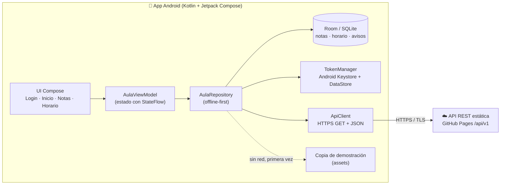
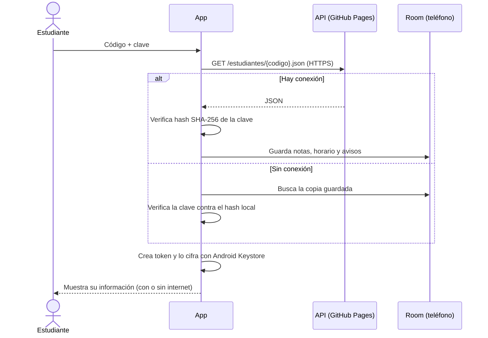
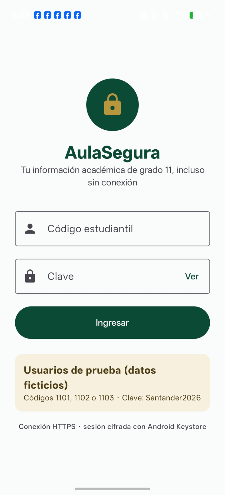
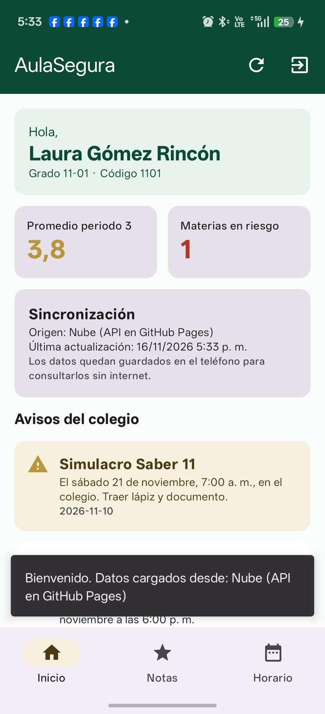
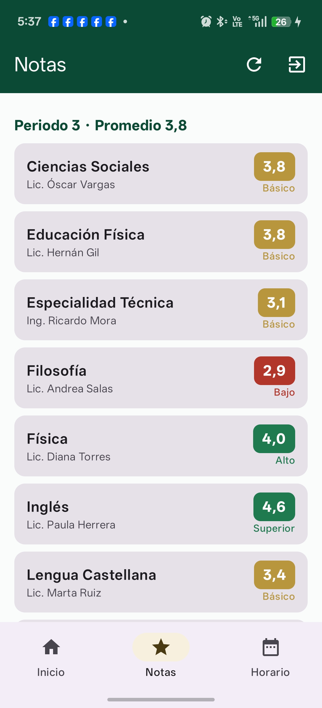
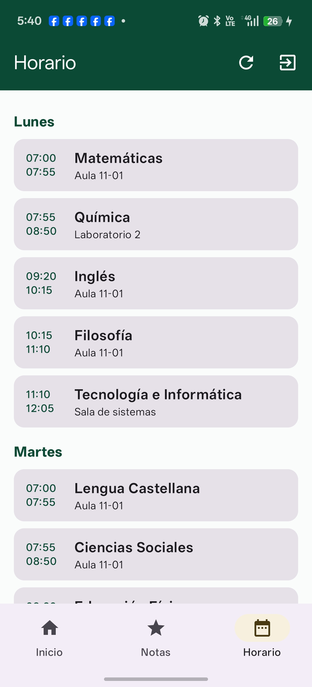
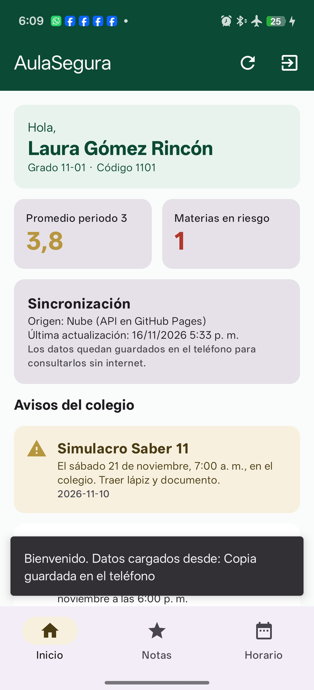

# 🛡️ AulaSegura

**Aplicación móvil Android *offline-first* y segura para la consulta de información académica de estudiantes de grado 11**

Proyecto del Taller ABP — *Diseño de Aplicaciones para Móviles* · Ingeniería Informática · Fundación Universitaria Católica del Norte · 2026

Autor: **Alexander Pardo Rodríguez**


-3DDC84?logo=android&logoColor=white)


---

## 📌 Entregables

1. **Landing page del proyecto:** https://dietusche.github.io/AulaSegura/
2. **API JSON en la nube:** https://dietusche.github.io/AulaSegura/api/v1/avisos.json
3. **Presentación (diapositivas):** [`/presentacion`](presentacion/)
4. **Video de sustentación (YouTube):** _pendiente: pegar enlace aquí_
5. **Evidencias (capturas de pantalla):** [`/evidencias`](evidencias/)

---

## 1. Planteamiento del problema

En la I.E. Colegio Técnico Francisco de Paula Santander (Villavicencio, Meta), los estudiantes de grado 11 consultan sus notas, su horario y los avisos institucionales por canales dispersos: grupos de mensajería, boletines impresos y plataformas web que no están pensadas para el celular. Muchos estudiantes tienen datos móviles limitados o conectividad intermitente. El resultado es que se enteran tarde de su situación académica, justo en el año en que preparan las pruebas Saber 11 y su proyecto de grado técnico.

Además, la información académica es un dato personal (Ley 1581 de 2012). Cualquier solución móvil debe protegerla frente a accesos no autorizados, robo de credenciales y exposición de datos guardados en el teléfono.

### Pregunta problema

> ¿De qué manera una aplicación móvil nativa en Android (Kotlin y Jetpack Compose) con arquitectura *offline-first* y controles de seguridad alineados con el OWASP Mobile Top 10 permite a los estudiantes de grado 11 consultar su información académica de forma oportuna, incluso con conectividad limitada, sin exponer sus datos personales?

## 2. Objetivos

**Objetivo general (SMART).** Desarrollar, en 8 semanas, una aplicación Android en Kotlin y Jetpack Compose que permita a los estudiantes de grado 11 consultar notas, horario y avisos. La meta es que el 100 % de la información quede disponible sin conexión después del primer inicio de sesión, con pantallas que carguen desde la copia local en menos de 2 segundos y con tres controles de seguridad del OWASP Mobile Top 10 implementados.

**Objetivos específicos**

1. **Investigación y diseño UX/UI:** identificar las necesidades del estudiante y diseñar un flujo de tres pantallas (inicio, notas, horario) con navegación inferior y Material Design 3.
2. **Desarrollo e integración:** programar la app con arquitectura MVVM, consumir una API REST en formato JSON alojada en la nube (GitHub Pages) y persistir los datos en Room.
3. **Pruebas y validación:** verificar el funcionamiento con y sin conexión en el emulador, ejecutar pruebas unitarias del módulo de autenticación y documentar los resultados.

## 3. Alcance

**Incluye:** inicio de sesión por código estudiantil, consulta de notas por periodo con escala de desempeño (Decreto 1290 de 2009), horario semanal, avisos institucionales, modo sin conexión y sesión cifrada.

**No incluye (trabajo futuro):** registro de notas por docentes, notificaciones push, backend con base de datos real y publicación en Google Play.

> ⚠️ Todos los datos de estudiantes del proyecto son **ficticios** y se usan solo con fines académicos.

## 4. Metodología

Se trabajó con **Scrum adaptado a un desarrollador individual**, en sprints semanales:

| Sprint | Entregable |
|---|---|
| 1 | Análisis del problema, historias de usuario y diseño de pantallas |
| 2 | Proyecto base en Android Studio, tema visual y navegación |
| 3 | API JSON en GitHub Pages, cliente HTTPS y modelo de datos Room |
| 4 | Seguridad (Keystore, HTTPS, sin respaldos), pruebas y documentación |

## 5. Arquitectura de la solución

La app sigue la arquitectura recomendada por Android: **UI → ViewModel → Repository → fuentes de datos** (patrón MVVM con una única fuente de verdad).



### Flujo *offline-first* al iniciar sesión



### Estructura de carpetas

```
AulaSegura/
├── app/src/main/java/com/alexanderpardo/aulasegura/
│   ├── MainActivity.kt            # Punto de entrada
│   ├── data/
│   │   ├── AulaRepository.kt      # Lógica offline-first (única fuente de verdad)
│   │   ├── local/                 # Room: entidades, DAO, base de datos
│   │   ├── remote/                # Cliente HTTPS, configuración y parser JSON
│   │   └── security/              # Keystore (token) y hash de claves
│   └── ui/
│       ├── AulaViewModel.kt       # Estado de la interfaz (MVVM)
│       ├── screens/               # Pantallas en Jetpack Compose
│       └── theme/                 # Colores y tema Material 3
├── app/src/main/assets/api/v1/    # Copia de demostración de la API
├── app/src/test/                  # Pruebas unitarias
├── docs/                          # Landing page + API JSON (GitHub Pages)
├── presentacion/                  # Diapositivas del proyecto
└── evidencias/                    # Capturas de pantalla
```

### Tecnologías y justificación

| Tecnología | Uso | ¿Por qué? |
|---|---|---|
| Kotlin 2.0 | Lenguaje | Lenguaje oficial de Android: conciso y con seguridad frente a nulos |
| Jetpack Compose + Material 3 | Interfaz | UI declarativa, menos código y diseño moderno y accesible |
| ViewModel + StateFlow | Estado | Sobrevive a rotaciones y separa la lógica de la vista |
| Room (SQLite) | Persistencia | Datos estructurados con consultas SQL; ideal para trabajar sin conexión |
| DataStore + Android Keystore | Sesión | Guarda el token cifrado con una clave protegida por hardware |
| HttpsURLConnection + org.json | Red | Consumo de la API REST sin dependencias extra |
| GitHub Pages | Nube | Hosting gratuito con HTTPS para la API JSON y la landing |

## 6. Seguridad (OWASP Mobile Top 10, 2024)

| Riesgo | Categoría OWASP | Control implementado | Dónde está en el código |
|---|---|---|---|
| Tráfico interceptado en redes Wi-Fi públicas | M5 · Insecure Communication | Solo HTTPS/TLS; el tráfico HTTP está bloqueado | `res/xml/network_security_config.xml`, `ApiClient.kt` |
| Robo del token o de la clave | M1 · Improper Credential Usage | La clave nunca se guarda (solo se compara su hash SHA-256 en tiempo constante); el token se cifra con AES-256-GCM y una clave del Android Keystore, y vence a las 8 horas | `PasswordHasher.kt`, `TokenManager.kt` |
| Exposición de datos guardados en el teléfono | M9 · Insecure Data Storage | Respaldos y transferencias deshabilitados; solo se guardan los datos necesarios | `AndroidManifest.xml`, `res/xml/data_extraction_rules.xml` |

**Limitaciones conocidas y mejoras futuras.** La API de este prototipo es estática (GitHub Pages), así que el hash de la clave viaja en el JSON. En producción, un servidor validaría la clave y emitiría un **JWT** de corta duración (por ejemplo, con Firebase Authentication). También se proponen como mejoras el cifrado completo de la base de datos con **SQLCipher** y el **SSL Pinning** del certificado institucional.

## 7. Instalación y ejecución

**Requisitos:** Android Studio (versión reciente), conexión a internet la primera vez que se compila, y un emulador o un celular con Android 8.0 o superior.

1. Clonar el repositorio:
   ```bash
   git clone https://github.com/dietusche/AulaSegura.git
   ```
2. En Android Studio, abrir la carpeta con **File → Open** y esperar a que termine *Gradle Sync*.
3. Elegir un emulador (Device Manager) y pulsar **Run ▶**.
4. Ingresar con un usuario de prueba: código **1101**, **1102** o **1103**; clave **Santander2026**.

**Despliegue de la API en la nube**

1. En GitHub: **Settings → Pages → Source: Deploy from a branch → `main` / `/docs`**.
2. Copiar la URL publicada y pegarla en `app/src/main/java/.../data/remote/ApiConfig.kt` (`BASE_URL`).
3. Volver a ejecutar la app. En la pantalla de inicio, el origen de los datos aparece como **"Nube (API en GitHub Pages)"**.

**Pruebas unitarias:** clic derecho sobre `app/src/test` → **Run 'Tests in aulasegura'**.

## 8. Evidencias y resultados

| Inicio de sesión | Inicio | Notas | Horario | Modo sin conexión |
|---|---|---|---|---|
|  |  |  |  |  |

**Resultados obtenidos**

- ✅ La app consume la API JSON publicada en GitHub Pages mediante HTTPS.
- ✅ Después del primer inicio de sesión, notas, horario y avisos se consultan sin conexión (modo avión).
- ✅ Las pruebas unitarias del módulo de autenticación pasan (4 de 4).
- ✅ Tres controles de seguridad alineados con el OWASP Mobile Top 10.

## 9. Costos estimados de publicación

| Concepto | Tipo de costo | Valor (USD) |
|---|---|---|
| Google Play Console | Pago único | 25 |
| API y landing en GitHub Pages | Mensual | 0 (gratuito) |
| Backend futuro (Firebase Auth + Firestore) | Mensual | 0 – 15 (capa gratuita al inicio) |
| **Total inicial** | | **≈ 25 – 40** |

Para la sustentación, la app se ejecuta localmente en el emulador; no es necesario publicarla en la tienda.

## 10. Declaración de uso de inteligencia artificial

En este proyecto se usó Claude (Anthropic) como asistente para generar código base, redactar la documentación y diseñar la presentación. El autor revisó, ejecutó, probó y ajustó la solución, y responde por su contenido técnico. Este uso es coherente con el enfoque del curso, que promueve aprovechar asistentes de IA para el desarrollo.

## 11. Referencias (APA 7.ª ed.)

- Android Developers. (2026). *Guide to app architecture*. https://developer.android.com/topic/architecture
- Android Developers. (2026). *Save data in a local database using Room*. https://developer.android.com/training/data-storage/room
- Android Developers. (2026). *Android Keystore system*. https://developer.android.com/privacy-and-security/keystore
- Android Developers. (2026). *Network security configuration*. https://developer.android.com/privacy-and-security/security-config
- Congreso de Colombia. (2012). *Ley Estatutaria 1581 de 2012, por la cual se dictan disposiciones generales para la protección de datos personales*.
- Ministerio de Educación Nacional. (2009). *Decreto 1290 de 2009*.
- OWASP Foundation. (2024). *OWASP Mobile Top 10*. https://owasp.org/www-project-mobile-top-10/
- Sommerville, I. (2016). *Ingeniería de software* (10.ª ed.). Pearson.
